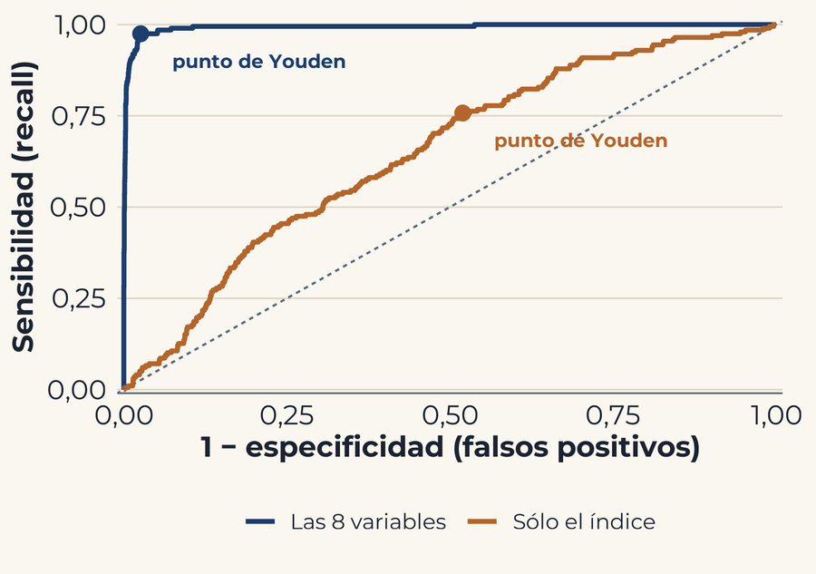
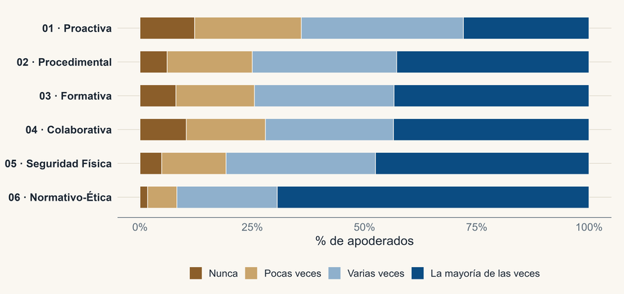

# Carlos Pizarro Fuentes

Estudiante de cuarto año de Ingeniería Estadística en la Universidad de Santiago de Chile.
También trabajo en Gráfica Creativa SpA, una imprenta familiar. Ayudo con la cobranza y la
facturación, y ordeno los datos de la empresa para responder preguntas del día a día: a qué compras de Mercado Público vale la pena postular,
cuánto cobrar por un trabajo y cuánto deja realmente cada uno una vez pagados los costos.

Trabajo sobre todo con R, Python y SQL.

## Proyectos

<table>
  <tr>
    <td width="50%" valign="top">
      
       
      <a href="https://github.com/cpizarrof/deprivacion-multivariante"><b>La deprivación urbana en Chile no es unidimensional</b></a>
       
      Análisis multivariante de las 4.843 zonas censales urbanas del Censo 2017.
      <a href="https://cpizarrof.github.io/deprivacion-multivariante/">Ver la presentación</a>
    </td>
    <td width="50%" valign="top">
      
       
      <a href="https://github.com/cpizarrof/pgip-psicometria"><b>Percepción de la gestión preventiva en colegios</b></a>
       
      Construcción y validación de una escala con datos del Simce 2024.
      <a href="https://cpizarrof.github.io/pgip-psicometria/">Ver la presentación</a>
    </td>
  </tr>
</table>

[Currículum](https://cpizarrof.github.io/cv/) · [Portafolio](https://cpizarrof.github.io/Portafolio/) · [LinkedIn](https://www.linkedin.com/in/carlos-pizarro-fuentes/) · carlos.pizarro.f@usach.cl
